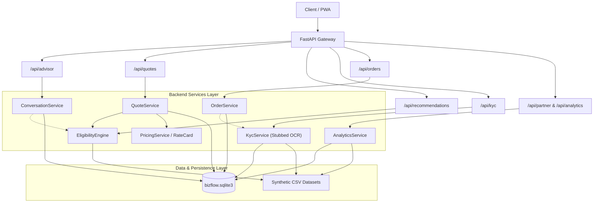
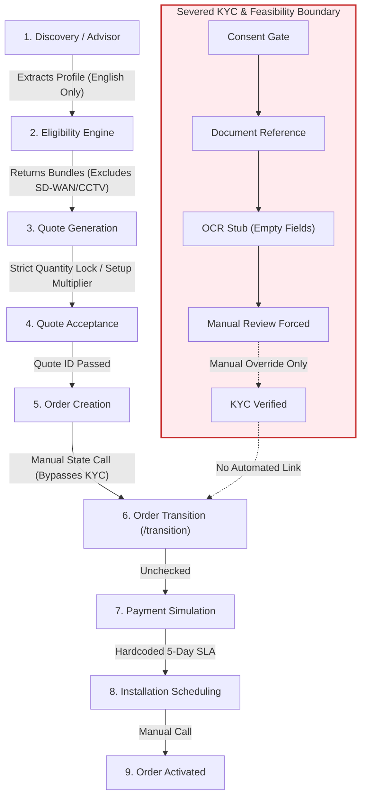
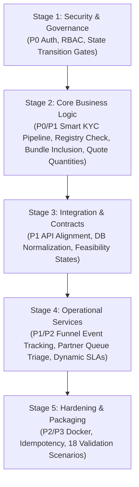

# ACCEL BIZFLOW v2.0
## Independent Backend Architecture, Implementation, and Compliance Audit Report

**Auditor:** Senior Backend Architect, Software Engineer & Independent Technical Auditor  
**Date:** 2026-11-07  
**Scope:** Complete Backend Repository (`backend/`), Data Contracts (`YTL_TrackA_Udyam_Digital_Data/`), Analysis Notebooks (`analysis/`), and Test Suite (`backend/tests/`)  
**Source of Truth:** [`Roadmap.md`](file:///c:/Users/ACER/Downloads/AirtelSync/Roadmap.md) (Locked Baseline v1.0)  

---

## A. EXECUTIVE SUMMARY

An independent technical audit was conducted on the existing Accel BizFlow backend repository to verify whether the implementation faithfully realizes the approved business problem, architectural blueprint, and locked [`Roadmap.md`](file:///c:/Users/ACER/Downloads/AirtelSync/Roadmap.md).

### 1. Overall Backend Health
The backend represents an early-stage modular-monolith prototype with well-structured foundations in **Phase 1 (Catalogue & Eligibility)** and basic arithmetic in **Phase 2 (Pricing)**. However, downstream phases (Phase 3 through Phase 6) exhibit significant architectural divergence, stubbed business logic, severed data linkages, hardcoded outputs, and severe security gaps. While the automated test suite reports **32 passing tests**, these tests cover only isolated happy paths and mocked states, masking critical defects in core workflows.

### 2. Overall Blueprint Compliance
- **Phase 0 (Foundation & Business Analysis):** **PARTIALLY COMPLIANT**. Business analysis metrics are reproduced in [`phase_0_business_analysis.ipynb`](file:///c:/Users/ACER/Downloads/AirtelSync/analysis/phase_0_business_analysis.ipynb), but the requested standalone script [`lead_analysis.py`](file:///c:/Users/ACER/Downloads/AirtelSync/analytics/lead_analysis.py) is missing.
- **Phase 1 (Catalogue & Eligibility):** **COMPLIANT WITH LIMITATION**. All 25 products are validated and loaded. Segment, tier, employee, site, and GSTIN rules are enforced. However, bundle composition excludes all products requiring companion connectivity (`requires_one_of`), preventing high-value multi-site items (SD-WAN, CCTV, Failover) from appearing in generated bundles.
- **Phase 2 (Pricing & Quotes):** **PARTIALLY COMPLIANT**. Midpoint rate cards and decimal arithmetic reconcile cleanly. However, quote item quantities are rigidly forced to equal recommended defaults, completely disabling customer and sales quote customizability. Furthermore, setup fees are multiplied by quantity without commercial justification, quotes lack relational item storage, and quote creation lacks idempotency.
- **Phase 3 (Conversational Advisor):** **NON-COMPLIANT / SEVERED**. The advisor is not truly conversational. Deterministic extraction relies on rigid English-only regexes (failing on Hindi/Hinglish). If Ollama is unavailable, the fallback returns empty fields. Crucially, the advisor never generates natural language explanations of recommendations or pricing, and never attaches quotes.
- **Phase 4 (Feasibility & Smart KYC):** **CRITICAL NON-COMPLIANCE**. Smart KYC document processing is a placeholder stub. The OCR pipeline does not extract fields, always returns `confidence: 0.0`, `fields: {}`, and hardcodes status to `MANUAL_REVIEW`. Registry verification is completely disconnected from document processing, ignores cancelled/suspended GST statuses, and automated `VERIFIED` status is unreachable. All 47 dataset documents across 12 applicants evaluated to `MANUAL_REVIEW` due to missing OCR dependencies and unexecuted extraction.
- **Phase 5 (Orders & Tracker):** **NON-COMPLIANT INTEGRATION**. Order creation is decoupled from KYC and feasibility prerequisites. Any client can transition orders through arbitrary states via unauthenticated API calls. Product-specific install timelines are ignored in favor of a hardcoded 5-day ETA.
- **Phase 6 (Partner Operations & Analytics):** **PARTIALLY COMPLIANT / HARDCODED**. The `/api/analytics/funnel` endpoint returns a hardcoded static dictionary from historical data rather than computing live funnel metrics. The partner queue does not reflect case assignments, filtering is missing, and operational triage is incomplete.

### 3. Readiness Verdict
**NOT READY FOR FRONTEND INTEGRATION**. Integrating a frontend against the current backend would immediately stall due to broken KYC extraction, mismatched API endpoints, unconfigurable quote quantities, hardcoded funnel analytics, and unauthenticated administrative controls.

---

## B. PHASE-WISE IMPLEMENTATION SCORECARD

| Phase | Roadmap Requirements | Implemented | Partial | Missing | Audit Verdict |
|---|---:|---:|---:|---:|---|
| **Phase 0 — Foundation & Analysis** | 6 | 4 | 2 | 0 | **PARTIALLY COMPLIANT** |
| **Phase 1 — Catalogue & Eligibility** | 8 | 7 | 1 | 0 | **COMPLIANT WITH DEFECTS** |
| **Phase 2 — Pricing & Quotes** | 10 | 6 | 3 | 1 | **PARTIALLY COMPLIANT** |
| **Phase 3 — Conversational Advisor** | 9 | 3 | 3 | 3 | **NON-COMPLIANT** |
| **Phase 4 — Feasibility & Smart KYC** | 12 | 2 | 4 | 6 | **CRITICAL DEFECTS** |
| **Phase 5 — Orders & Tracker** | 10 | 4 | 4 | 2 | **NON-COMPLIANT** |
| **Phase 6 — Partner & Analytics** | 8 | 3 | 3 | 2 | **PARTIALLY COMPLIANT** |
| **Phase 7 — Packaging & Hardening** | 5 | 1 | 0 | 4 | **MISSING** |

---

## C. REQUIREMENT TRACEABILITY MATRIX

| Req ID | Roadmap Phase | Exact Requirement | Expected Behaviour | Relevant Implementation Files | Verification Method & Audit Status |
|---|---|---|---|---|---|
| **REQ-01** | Phase 0 | Reproduce locked baseline funnel metrics | Funnel: 5000 leads, 3406 contacted, 1974 assessed, 861 quote accepted, 588 KYC complete, 368 activated | [`analysis/phase_0_business_analysis.ipynb`](file:///c:/Users/ACER/Downloads/AirtelSync/analysis/phase_0_business_analysis.ipynb) | **VERIFIED**: Cell 4 validates exact counts. Missing standalone script `lead_analysis.py`. |
| **REQ-02** | Phase 0 | Reproduce segment economics & value proxy | Multi-site + manufacturing represent ~71.2% of monthly value proxy with ~20.9% leads | [`analysis/phase_0_business_analysis.ipynb`](file:///c:/Users/ACER/Downloads/AirtelSync/analysis/phase_0_business_analysis.ipynb) | **VERIFIED**: Cell 6 calculates Wilson CIs, value proxy shares matching baseline. |
| **REQ-03** | Phase 1 | Import all 25 catalogue products with typed schemas | Validate 25 products, units, price bounds, city tiers, dependencies | [`backend/app/services/catalogue/loader.py`](file:///c:/Users/ACER/Downloads/AirtelSync/backend/app/services/catalogue/loader.py#L35-L91) [`backend/app/schemas/products.py`](file:///c:/Users/ACER/Downloads/AirtelSync/backend/app/schemas/products.py#L24-L65) | **VERIFIED**: Loaded via `load_catalogue()`. Validated against `SUPPORTED_UNITS` and column requirements. |
| **REQ-04** | Phase 1 | Enforce segment, tier, employee, site, GSTIN eligibility | Filter products deterministically; return reasons for ineligible items | [`backend/app/services/eligibility/engine.py`](file:///c:/Users/ACER/Downloads/AirtelSync/backend/app/services/eligibility/engine.py#L57-L80) | **VERIFIED**: `_base_decision()` strictly enforces 5 criteria with explicit error reasons. |
| **REQ-05** | Phase 1 | Enforce `requires_one_of` companion dependency | Dependent products fail unless valid companion is in the same bundle | [`backend/app/services/eligibility/engine.py`](file:///c:/Users/ACER/Downloads/AirtelSync/backend/app/services/eligibility/engine.py#L100-L131) | **VERIFIED**: Hard same-bundle constraint enforced in `validate_bundle()`. |
| **REQ-06** | Phase 1 | Return Essential, Recommended, and Advanced bundles | Generate 3 distinct bundle configurations with valid dependencies | [`backend/app/services/eligibility/engine.py`](file:///c:/Users/ACER/Downloads/AirtelSync/backend/app/services/eligibility/engine.py#L154-L206) | **DEFECT (P1)**: Excludes all `requires_one_of` products, omitting SD-WAN, CCTV, and failover from all bundles. |
| **REQ-07** | Phase 2 | Versioned rate-card and midpoint pricing | Default price = `(price_min + price_max) / 2`; rate card version recorded | [`backend/app/services/pricing.py`](file:///c:/Users/ACER/Downloads/AirtelSync/backend/app/services/pricing.py#L15-L24) | **VERIFIED**: `RateCard.resolve_price()` uses midpoint with Decimal `ROUND_HALF_UP`. |
| **REQ-08** | Phase 2 | Quantity-based recurring and setup totals | Calculate recurring and setup charges; validate product units | [`backend/app/services/pricing.py`](file:///c:/Users/ACER/Downloads/AirtelSync/backend/app/services/pricing.py#L37-L49) | **DEFECT (P1)**: Multiplies one-time setup fee by quantity indiscriminately; quotes strictly forbid quantity customization. |
| **REQ-09** | Phase 2 | Accepted quote immutability & idempotency | Accepted quotes cannot be modified; accepting again is idempotent | [`backend/app/services/quotes.py`](file:///c:/Users/ACER/Downloads/AirtelSync/backend/app/services/quotes.py#L74-L101) | **VERIFIED**: `update_items()` raises ValueError if status == "ACCEPTED"; `accept()` is idempotent. |
| **REQ-10** | Phase 2 | Full line item reconciliation | Total quote price equals exact sum of item lines | [`backend/app/services/pricing.py`](file:///c:/Users/ACER/Downloads/AirtelSync/backend/app/services/pricing.py#L52-L67) | **VERIFIED**: Reconciled to minor currency units (paisa). |
| **REQ-11** | Phase 3 | Multilingual structured discovery (Hindi/English/Hinglish) | Extract structured business profile conversationally across languages | [`backend/app/services/advisor/conversation.py`](file:///c:/Users/ACER/Downloads/AirtelSync/backend/app/services/advisor/conversation.py#L24-L55) | **DEFECT (P1)**: Rigid English-only regexes. Fails on Hinglish/Hindi phrasing. |
| **REQ-12** | Phase 3 | Deterministic fallback & AI boundary isolation | LLM cannot decide eligibility/pricing; fallback to structured questions | [`backend/app/services/advisor/providers.py`](file:///c:/Users/ACER/Downloads/AirtelSync/backend/app/services/advisor/providers.py#L88-L107) | **PARTIAL**: Seam exists, but `DeterministicAdvisorProvider` returns all `None`, and questions are hardcoded English. |
| **REQ-13** | Phase 3 | Plain language explanations of recommendations & pricing | Explain verified recommendation reasons and pricing breakdown | [`backend/app/services/advisor/conversation.py`](file:///c:/Users/ACER/Downloads/AirtelSync/backend/app/services/advisor/conversation.py#L116-L124) | **MISSING (P1)**: Outputs single static string; does not explain reasons, pricing, or attach quote. |
| **REQ-14** | Phase 4 | Feasibility simulation with 4 states and validity window | Return `AVAILABLE`, `ALTERNATIVE_AVAILABLE`, `SURVEY_REQUIRED`, `NOT_FEASIBLE` | [`backend/app/services/kyc.py`](file:///c:/Users/ACER/Downloads/AirtelSync/backend/app/services/kyc.py#L71-L91) [`backend/app/schemas/kyc.py`](file:///c:/Users/ACER/Downloads/AirtelSync/backend/app/schemas/kyc.py#L13-L21) | **DEFECT (P1)**: Implements `FEASIBLE`, `NOT_FEASIBLE`, `MANUAL_REVIEW`. Missing validity window & timestamps. |
| **REQ-15** | Phase 4 | Explicit purpose-specific consent before document processing | Block document processing until explicit consent is recorded | [`backend/app/services/kyc.py`](file:///c:/Users/ACER/Downloads/AirtelSync/backend/app/services/kyc.py#L61-L69) | **VERIFIED**: `_require_consent()` enforces consent check before document handling. |
| **REQ-16** | Phase 4 | Local OCR extraction with field confidence | Extract fields locally; low confidence routes to review/action required | [`backend/app/services/kyc.py`](file:///c:/Users/ACER/Downloads/AirtelSync/backend/app/services/kyc.py#L104-L139) | **CRITICAL DEFECT (P0)**: Stubbed. Never parses or extracts fields; confidence always 0.0; always returns `MANUAL_REVIEW`. |
| **REQ-17** | Phase 4 | Mock GSTIN and Udyam registry validation | Check format, status, and identity match; suspended/cancelled blocks | [`backend/app/services/kyc.py`](file:///c:/Users/ACER/Downloads/AirtelSync/backend/app/services/kyc.py#L141-L155) | **DEFECT (P1)**: Disconnected from KYC workflow; ignores cancelled/suspended statuses in `mock_gstin_registry.csv`. |
| **REQ-18** | Phase 4 | Four KYC outcomes reachable via valid scenarios | `VERIFIED`, `ACTION_REQUIRED`, `MANUAL_REVIEW`, `REJECTED` | [`backend/app/services/kyc.py`](file:///c:/Users/ACER/Downloads/AirtelSync/backend/app/services/kyc.py#L178-L202) | **DEFECT (P0)**: Automated pipeline only reaches `MANUAL_REVIEW`. `VERIFIED` requires manual override. |
| **REQ-19** | Phase 4 | Process all 47 supplied documents across 12 applicants | Evaluate dataset and generate machine-readable summary | [`backend/scripts/process_kyc_dataset.py`](file:///c:/Users/ACER/Downloads/AirtelSync/backend/scripts/process_kyc_dataset.py#L1-L35) [`backend/data/kyc_processing_summary.json`](file:///c:/Users/ACER/Downloads/AirtelSync/backend/data/kyc_processing_summary.json) | **VERIFIED BUT FAILED**: All 47 documents evaluated to `MANUAL_REVIEW` due to missing OCR dependencies and zero extraction logic. |
| **REQ-20** | Phase 5 | Create order only from accepted quote | Prevent order creation from unaccepted quotes; enforce duplicate prevention | [`backend/app/services/orders.py`](file:///c:/Users/ACER/Downloads/AirtelSync/backend/app/services/orders.py#L60-L91) | **VERIFIED**: Requires `quote.status == "ACCEPTED"`; duplicate quote_id returns existing order. |
| **REQ-21** | Phase 5 | Validated state machine & append-only event log | Authorize explicit transitions; record actor, timestamps, and reasons | [`backend/app/services/orders.py`](file:///c:/Users/ACER/Downloads/AirtelSync/backend/app/services/orders.py#L8-L28,L100-L115) | **DEFECT (P0)**: State transitions accept arbitrary unverified actors; completely decoupled from actual KYC/feasibility state. |
| **REQ-22** | Phase 5 | Simulated payment with retry/failure handling | Support payment failure and retry without false activation | [`backend/app/services/orders.py`](file:///c:/Users/ACER/Downloads/AirtelSync/backend/app/services/orders.py#L116-L137) | **VERIFIED**: Payment failure transitions to `PAYMENT_FAILED`; permits retry to `PAYMENT_PENDING`. |
| **REQ-23** | Phase 5 | Installation scheduling based on feasibility and product SLA | Schedule only feasible sites; calculate ETA from product install days | [`backend/app/services/orders.py`](file:///c:/Users/ACER/Downloads/AirtelSync/backend/app/services/orders.py#L139-L162) | **DEFECT (P2)**: Hardcodes 5-day ETA; completely ignores product's `typical_install_days`. |
| **REQ-24** | Phase 6 | Partner operational queues and assignment triage | View exceptions (quotes, KYC, payments, delays); assign cases | [`backend/app/services/analytics.py`](file:///c:/Users/ACER/Downloads/AirtelSync/backend/app/services/analytics.py#L66-L89) | **DEFECT (P2)**: Queue does not show current assignee; lacks filtering by priority or owner; no reassignment/closure. |
| **REQ-25** | Phase 6 | Point-in-time lead scoring without target leakage | Relative prioritization score using only discovery inputs | [`backend/app/services/analytics.py`](file:///c:/Users/ACER/Downloads/AirtelSync/backend/app/services/analytics.py#L41-L64) | **VERIFIED**: Rule-based score uses only point-in-time features (employees, sites, GSTIN, spend). |
| **REQ-26** | Phase 6 | Funnel & segment analytics | Reproduce funnel, conversion, CAC, and drop reasons | [`backend/app/services/analytics.py`](file:///c:/Users/ACER/Downloads/AirtelSync/backend/app/services/analytics.py#L16-L40) | **DEFECT (P1)**: `/api/analytics/funnel` returns static hardcoded dictionary; does not track live prototype funnel. |
| **REQ-27** | Phase 7 | Docker containerization & reproducible startup | Dockerfile and docker-compose.yml for clean environment startup | Repository root | **MISSING (P2)**: No Docker configuration files exist in the repository. |

---

## D. ARCHITECTURE REVIEW

### 1. Structure and Modularity
The codebase follows a modular layout under [`backend/app`](file:///c:/Users/ACER/Downloads/AirtelSync/backend/app), dividing responsibilities into `api/`, `schemas/`, `services/`, and `database.py`. However, it deviates from the approved blueprint in several critical areas:
- **No Models Directory:** Database entities are lumped into a single [`database.py`](file:///c:/Users/ACER/Downloads/AirtelSync/backend/app/database.py) file rather than a dedicated `models/` module.
- **Inconsistent Service Dependency Injection:** In [`main.py`](file:///c:/Users/ACER/Downloads/AirtelSync/backend/app/main.py#L32), `OrderService` is instantiated with `quote_service=None`, bypassing the quotation service and leaving unused dead parameters in `OrderService.__init__`.

### 2. API Design Discrepancies
The implemented routes depart significantly from Roadmap Section 7 (lines 453–459):
- **Missing Endpoints:** `POST /api/leads`, `GET /api/leads/{id}`, `GET /api/catalog/products`, `GET /api/catalog/products/{id}`, `POST /api/kyc/cases`.
- **Mismatched Path Conventions:**
  - Roadmap specifies `POST /api/feasibility/check`; code implements `POST /api/kyc/feasibility`.
  - Roadmap specifies `POST /api/advisor/sessions` and `POST /api/advisor/sessions/{id}/messages`; code implements a single `POST /api/advisor/message`.
  - Roadmap specifies `POST /api/kyc/cases/{id}/consent` and `POST /api/kyc/cases/{id}/documents`; code implements unnested endpoints `/api/kyc/consent` and `/api/kyc/documents`.

### 3. Database Design and Invariants
- **Unnormalized JSON Columns:** [`QuoteRecord`](file:///c:/Users/ACER/Downloads/AirtelSync/backend/app/database.py#L12-L26) and [`OrderRecord`](file:///c:/Users/ACER/Downloads/AirtelSync/backend/app/database.py#L77-L88) store line items and business profiles as serialized JSON strings (`items_json`, `profile_json`, `snapshot_json`) rather than relational rows. There is no `quote_items` table.
- **Unenforced Foreign Keys:** SQLite does not enforce foreign keys by default. [`create_session_factory`](file:///c:/Users/ACER/Downloads/AirtelSync/backend/app/database.py#L135-L139) omits the SQLite `PRAGMA foreign_keys = ON;` connection hook. Foreign key constraints are ignored.
- **Missing Blueprint Tables:** The database lacks tables for `leads`, `business_profiles`, `products`, `pricing_versions`, `feasibility_checks`, `kyc_documents`, and `lead_scores`.
- **No Schema Migrations:** No Alembic configuration or migration scripts exist (`alembic.ini` is absent). Schema relies solely on `Base.metadata.create_all()`.

---

## E. CROSS-PHASE INTEGRATION AUDIT

The end-to-end customer journey was audited to trace state across service boundaries:

### Critical Journey Disconnects:
1. **Advisor to Quote:** While [`ConversationService`](file:///c:/Users/ACER/Downloads/AirtelSync/backend/app/services/advisor/conversation.py#L113-L124) calls the eligibility engine when discovery is complete, it **never generates or returns a quote**, leaving the `quote` field in `AdvisorMessageResponse` permanently `null`.
2. **KYC to Order:** Order creation ([`OrderService.create`](file:///c:/Users/ACER/Downloads/AirtelSync/backend/app/services/orders.py#L60-L91)) requires an accepted quote, but **does not check whether the applicant has completed KYC or granted consent**.
3. **Order State to KYC Status:** The state transition endpoint [`POST /api/orders/{order_id}/transition`](file:///c:/Users/ACER/Downloads/AirtelSync/backend/app/services/orders.py#L100-L115) allows any client to advance an order from `KYC_PENDING` to `KYC_VERIFIED` and `FEASIBILITY_CLEARED` without querying [`KycCaseRecord`](file:///c:/Users/ACER/Downloads/AirtelSync/backend/app/database.py#L57-L65) or running a feasibility check.
4. **Feasibility to Order Creation:** Feasibility is checked only at installation scheduling. An order can be accepted, verified, and paid for an address that is completely infeasible.

---

## F. SECURITY AND PRIVACY AUDIT

| Security Category | Blueprint Requirement | Actual Implementation | Audit Finding & Classification |
|---|---|---|---|
| **Authentication & RBAC** | Role-based access for customers, sales, and reviewers | Completely absent. Reviewer ID is read directly from client header `X-Reviewer-Id`; order transitions accept arbitrary client strings for `actor`. | **P0 (Critical)**: Open administrative endpoints. |
| **Path Traversal & Storage** | Private storage, prevent directory traversal | [`KycService.document`](file:///c:/Users/ACER/Downloads/AirtelSync/backend/app/services/kyc.py#L96-L100) validates `Path(file_name).name == file_name` and checks `parent` containment. | **Secure**: Direct traversal blocked. |
| **File Upload Handling** | Secure binary upload and validation | No binary upload endpoint exists. API only accepts string filenames of pre-existing synthetic files. | **P1 (High)**: Incomplete feature; genuine customer document uploads unsupported. |
| **PII & Logging Hygiene** | Mask identifiers; exclude raw documents from logs | Registry masks identifiers (`32T***ZW`); audit events log only metadata, not raw images. | **Demonstrably Secure**: Complies with masking baseline. |
| **Prompt Injection** | Treat user input as untrusted; allowlist structured extraction | User text is concatenated directly into prompt in [`OllamaProvider.extract_profile`](file:///c:/Users/ACER/Downloads/AirtelSync/backend/app/services/advisor/providers.py#L52-L66). Output is schema-validated via Pydantic. | **P2 (Medium)**: Vulnerable to extraction manipulation, mitigated by Pydantic schema validation. |
| **SQL Injection** | Parameterized queries | SQLAlchemy 2.0 ORM expressions used throughout. No raw string SQL execution. | **Demonstrably Secure**. |
| **Consent Enforcement** | Explicit consent blocks processing | [`KycService._require_consent`](file:///c:/Users/ACER/Downloads/AirtelSync/backend/app/services/kyc.py#L61-L69) verifies granted consent before processing documents. | **Demonstrably Secure** for document routes (bypassed in order transitions). |

---

## G. TESTING COVERAGE AND EXECUTION AUDIT

### Execution Results
The test suite was executed in PowerShell (`Set-Location backend; python -m pytest backend/tests -v`):
- **Tests Discovered:** 32
- **Tests Passed:** 32 (100%)
- **Warnings:** 2 (Pydantic / Starlette deprecations)
- **Duration:** 6.88s

### Test Suite Evaluation:
Despite passing 100%, the tests suffer from severe coverage limitations:
1. **Mocked Happy Paths:** [`test_phase234.py`](file:///c:/Users/ACER/Downloads/AirtelSync/backend/tests/test_phase234.py#L56-L69) tests KYC outcomes by having the test client call the manual reviewer override endpoint (`/review`) three times with different strings, completely skipping document OCR verification.
2. **Artificial State Transitions:** [`test_phase56.py`](file:///c:/Users/ACER/Downloads/AirtelSync/backend/tests/test_phase56.py#L60-L64) manually steps an order through `KYC_PENDING`, `KYC_VERIFIED`, and `FEASIBILITY_CLEARED` by feeding test strings to `/transition`, proving the vulnerability rather than validating real workflow integration.
3. **Missing Validation Scenarios:** Of the 18 mandatory validation scenarios specified in Roadmap Section 10, **11 are completely untested**:
   - Scenario 1 (Kirana micro-bundle): **Untested**.
   - Scenario 4 (Tier-2 manufacturer specialist option): **Untested**.
   - Scenario 8 (Fibre unavailable survey/alternative): **Untested**.
   - Scenario 9 (Add-on toggle repricing): **Untested** (`PATCH /quotes/{id}/items` never called).
   - Scenario 10 (Suspended/cancelled GSTIN blocking): **Untested** (fails in actual code).
   - Scenario 11 (Unreadable document action-required): **Untested**.
   - Scenario 12 (Address mismatch manual review): **Untested**.
   - Scenario 13 (Address proof >90 days freshness check): **Untested**.
   - Scenario 14 (Hinglish response structured profile): **Untested**.
   - Scenario 15 (Installation delay tracking & queue update): **Untested**.
   - Scenario 18 (Customer human-assistance request): **Untested**.

---

## H. PRIORITIZED DEFECT REGISTER

### P0 — Critical Defects

#### [FINDING-01] Smart KYC Document Processing is a Placeholder Stub
- **Severity:** P0 — Critical
- **Phase:** Phase 4 — Feasibility & Smart KYC
- **File:** [`backend/app/services/kyc.py`](file:///c:/Users/ACER/Downloads/AirtelSync/backend/app/services/kyc.py#L104-L139)
- **Requirement Affected:** Roadmap Section 6.6, Phase 4 Exit Gate.
- **Evidence:** `document()` sets `confidence = 0.0`, `fields = {}`, and hardcodes `status = "MANUAL_REVIEW"`. If PaddleOCR executes, it merely checks `if result:` and modifies the text string `reason`. Not a single field (name, address, GSTIN, Udyam registration) is extracted. Cross-document checks and date validation are nonexistent. All 47 dataset images evaluated to `MANUAL_REVIEW`.
- **Expected Behaviour:** Local OCR extracts key fields, calculates field confidence, verifies registration numbers against mock registries, validates document dates against `2026-07-15`, and produces `VERIFIED`, `ACTION_REQUIRED`, `MANUAL_REVIEW`, or `REJECTED`.
- **Impact:** Smart KYC is non-functional. 100% of applicants must be manually processed.
- **Recommendation:** Implement text parsing routines (regex for GSTIN, Udyam, dates, and names), integrate cross-document comparison, and evaluate deterministic decision rules.
- **Test Required:** Process specimen sets for K01 (clean), K04 (invalid), and verify automated `VERIFIED` and `ACTION_REQUIRED` outcomes without manual review.

#### [FINDING-02] Absence of Authentication and RBAC on Reviewer and Order Endpoints
- **Severity:** P0 — Critical
- **Phase:** Phase 4 & Phase 5
- **File:** [`backend/app/api/kyc.py`](file:///c:/Users/ACER/Downloads/AirtelSync/backend/app/api/kyc.py#L64) [`backend/app/api/orders.py`](file:///c:/Users/ACER/Downloads/AirtelSync/backend/app/api/orders.py#L31-L38)
- **Requirement Affected:** Roadmap Section 12 ("Role-based access for customers, reviewers, and sales").
- **Evidence:** Reviewer identity is read from client header `X-Reviewer-Id` with fallback to `"local-reviewer"`. In `orders.py`, `/orders/{id}/transition` allows any caller to pass arbitrary `actor` strings and force state changes.
- **Expected Behaviour:** Reviewer and operational actions require verified credentials and server-enforced roles.
- **Impact:** Any user can arbitrarily verify KYC cases, trigger state transitions, and mark orders activated.
- **Recommendation:** Introduce authentication middleware with role enforcement (`kyc_reviewer`, `partner`, `customer`).
- **Test Required:** Test 401 Unauthorized when calling `/review` or `/transition` without valid auth tokens.

#### [FINDING-03] Order State Transitions Bypass KYC and Feasibility Verification
- **Severity:** P0 — Critical
- **Phase:** Phase 5 — Orders & Tracker
- **File:** [`backend/app/services/orders.py`](file:///c:/Users/ACER/Downloads/AirtelSync/backend/app/services/orders.py#L100-L115)
- **Requirement Affected:** Roadmap Section 6.7, Phase 5 Exit Gate.
- **Evidence:** `transition()` only checks whether `new_state in TRANSITIONS[order.status]`. It never checks whether the applicant's KYC case is `VERIFIED` or whether feasibility cleared.
- **Expected Behaviour:** Transition to `KYC_VERIFIED` must verify that `KycCaseRecord.status == "VERIFIED"`. Transition to `FEASIBILITY_CLEARED` must verify feasibility records.
- **Impact:** Commercial and operational rules are completely bypassed; unverified or rejected applicants can be transitioned to payment and activation.
- **Recommendation:** Query [`KycCaseRecord`](file:///c:/Users/ACER/Downloads/AirtelSync/backend/app/database.py#L57-L65) within `transition()` when moving to `KYC_VERIFIED`; reject transition if KYC is not verified.
- **Test Required:** Attempt to transition order to `KYC_VERIFIED` when applicant KYC is `ACTION_REQUIRED`; assert 409 Conflict.

---

### P1 — High Defects

#### [FINDING-04] Mock Registry Lookup Ignores GSTIN Inactive Status
- **Severity:** P1 — High
- **Phase:** Phase 4 — Smart KYC
- **File:** [`backend/app/services/kyc.py`](file:///c:/Users/ACER/Downloads/AirtelSync/backend/app/services/kyc.py#L148-L155)
- **Requirement Affected:** Roadmap Section 6.6, Scenario 10.
- **Evidence:** `registry()` sets `status = "VALID" if identifier in records else "MANUAL_REVIEW"`. In [`mock_gstin_registry.csv`](file:///c:/Users/ACER/Downloads/AirtelSync/YTL_TrackA_Udyam_Digital_Data/mock_gstin_registry.csv), 167 records are "Cancelled" and 101 are "Suspended". All are returned as `VALID`.
- **Expected Behaviour:** Suspended or cancelled registrations must return `INVALID` or `ACTION_REQUIRED` and block onboarding.
- **Impact:** Ineligible or fraudulent businesses with cancelled GSTINs are admitted.
- **Recommendation:** Inspect `record["status"]`; if not `"Active"`, return `status = "INVALID"`.
- **Test Required:** Test registry lookup with a known cancelled GSTIN (e.g., from `mock_gstin_registry.csv`) and assert status is `INVALID`.

#### [FINDING-05] `requires_one_of` Products Excluded from All Generated Bundles
- **Severity:** P1 — High
- **Phase:** Phase 1 — Catalogue & Eligibility
- **File:** [`backend/app/services/eligibility/engine.py`](file:///c:/Users/ACER/Downloads/AirtelSync/backend/app/services/eligibility/engine.py#L164-L196)
- **Requirement Affected:** Roadmap Section 3, Section 6.3.
- **Evidence:** `_compose_bundles()` filters `standalone = [product for product in eligible if not product.requires_one_of]` and composes bundles exclusively from `standalone`. Consequently, P09 (Failover), P10 (SD-WAN), P11 (Static IP), P12 (SIP), P21 (Firewall), P22 (Wi-Fi), and P23 (CCTV) can never be recommended in any bundle.
- **Expected Behaviour:** When an eligible connectivity companion is in the bundle, dependent products should be included in Recommended or Advanced bundles.
- **Impact:** High-value multi-site bundles fail to offer SD-WAN, failover, or CCTV.
- **Recommendation:** Allow dependent products into bundles once their required connectivity companion is selected.
- **Test Required:** Run `recommend()` for a multi-site profile and verify P10 (SD-WAN) appears in the Recommended or Advanced bundle.

#### [FINDING-06] Quotes Strictly Forbid Quantity Customization
- **Severity:** P1 — High
- **Phase:** Phase 2 — Pricing & Quotes
- **File:** [`backend/app/services/quotes.py`](file:///c:/Users/ACER/Downloads/AirtelSync/backend/app/services/quotes.py#L36-L43)
- **Requirement Affected:** Roadmap Section 6.4 ("configurable quotes", "product quantities and units").
- **Evidence:** `_validate_items` asserts `item.quantity == expected`. For `per camera`, `per counter`, `per channel`, etc., `expected` is hardcoded to 1. If a customer requests 4 cameras, quote creation fails with `ValueError: P23 quantity must be 1 for this profile.`
- **Expected Behaviour:** Quantities should be configurable by the customer or partner within reasonable bounds (>= 1).
- **Impact:** Customers cannot customize line items, camera counts, or counter quantities.
- **Recommendation:** Treat `recommended_quantity` as a suggestion; validate `quantity >= 1` and validate minimum site/employee constraints.
- **Test Required:** Create a quote with `P23` quantity = 4; verify status 201 Created and correct price multiplication.

#### [FINDING-07] Setup Fees Multiplied by Quantity for Per-User/Per-Device Products
- **Severity:** P1 — High
- **Phase:** Phase 2 — Pricing & Quotes
- **File:** [`backend/app/services/pricing.py`](file:///c:/Users/ACER/Downloads/AirtelSync/backend/app/services/pricing.py#L47)
- **Requirement Affected:** Roadmap Section 6.4, Blueprint Commercial Definition.
- **Evidence:** `setup_total = money(Decimal(product.one_time_setup_inr) * quantity)`. Multiplying setup fees by quantity creates unrealistic setup charges for multi-user software packages.
- **Expected Behaviour:** Setup fees should follow commercial definitions (fixed per site or order for cloud products; per unit only for physical hardware).
- **Impact:** Commercial distortion; excessive charges for MSMEs onboarding multiple users.
- **Recommendation:** Implement setup fee logic conditioned on unit and product category.
- **Test Required:** Unit test setup calculations for software vs. hardware products.

#### [FINDING-08] Missing Core API Endpoints and Path Inconsistencies
- **Severity:** P1 — High
- **Phase:** Cross-Phase / API Surface
- **File:** [`backend/app/api/`](file:///c:/Users/ACER/Downloads/AirtelSync/backend/app/api/)
- **Requirement Affected:** Roadmap Section 7 (lines 453–459).
- **Evidence:** Missing endpoints: `POST /api/leads`, `GET /api/leads/{id}`, `GET /api/catalog/products`, `GET /api/catalog/products/{id}`, `POST /api/kyc/cases`. Mismatches: `/api/kyc/feasibility` vs `/api/feasibility/check`; `/api/advisor/message` vs `/api/advisor/sessions/{id}/messages`.
- **Expected Behaviour:** API routes must conform to Roadmap Section 7 contract.
- **Impact:** Frontend integration will fail due to route and contract 404s.
- **Recommendation:** Implement missing endpoints and align route paths with Roadmap Section 7.
- **Test Required:** API schema validation test against Roadmap endpoint list.

#### [FINDING-09] Feasibility State Enum and Persistence Mismatch
- **Severity:** P1 — High
- **Phase:** Phase 4 — Feasibility
- **File:** [`backend/app/schemas/kyc.py`](file:///c:/Users/ACER/Downloads/AirtelSync/backend/app/schemas/kyc.py#L15) [`backend/app/services/kyc.py`](file:///c:/Users/ACER/Downloads/AirtelSync/backend/app/services/kyc.py#L71-L91)
- **Requirement Affected:** Roadmap Section 6.5.
- **Evidence:** Schema uses `FEASIBLE`, `NOT_FEASIBLE`, `MANUAL_REVIEW`. Roadmap requires `AVAILABLE`, `ALTERNATIVE_AVAILABLE`, `SURVEY_REQUIRED`, `NOT_FEASIBLE`. Checks are not persisted; timestamps and validity windows are omitted.
- **Expected Behaviour:** Support all 4 blueprint feasibility states, persist checks in `feasibility_checks` table, and return validity window.
- **Impact:** Cannot communicate alternative connectivity options or survey requirements to customers.
- **Recommendation:** Refactor feasibility schema, add `feasibility_checks` DB table, and return timestamp + validity.
- **Test Required:** Call feasibility check on an alternative-eligible PIN and assert `ALTERNATIVE_AVAILABLE`.

#### [FINDING-10] Advisor Lacks Multilingual Discovery and Explanations
- **Severity:** P1 — High
- **Phase:** Phase 3 — Conversational Advisor
- **File:** [`backend/app/services/advisor/conversation.py`](file:///c:/Users/ACER/Downloads/AirtelSync/backend/app/services/advisor/conversation.py#L24-L55,L97-L124)
- **Requirement Affected:** Roadmap Section 6.2, Phase 3 Exit Gate.
- **Evidence:** Extraction uses rigid English regexes (`clinic`, `employees`). Hinglish words (`dukan`, `log`) fail. Questions and responses are hardcoded English strings. Never explains recommendation reasons or pricing.
- **Expected Behaviour:** Parse Hinglish/Hindi phrases into structured profiles; explain verified recommendation reasons and pricing in plain language.
- **Impact:** Non-English MSME owners cannot complete discovery or understand recommendations.
- **Recommendation:** Add Hinglish regex/dictionary mapping and implement LLM prompt to explain recommendation reasons.
- **Test Required:** Test conversation with Hinglish input: "Jaipur me clinic hai, 12 staff, GST hai" and verify extracted profile.

#### [FINDING-11] Funnel Analytics Endpoint Returns Static Hardcoded Mock Data
- **Severity:** P1 — High
- **Phase:** Phase 6 — Analytics
- **File:** [`backend/app/services/analytics.py`](file:///c:/Users/ACER/Downloads/AirtelSync/backend/app/services/analytics.py#L16-L26)
- **Requirement Affected:** Roadmap Section 6.9.
- **Evidence:** `funnel()` returns a static hardcoded dictionary: `{"leads": 5000, "contacted": 3406, ...}`. Does not track live prototype orders, drop reasons, CAC, or churn.
- **Expected Behaviour:** Compute live funnel counts and conversion rates from database events alongside historical data.
- **Impact:** Live prototype conversion and drop-off cannot be monitored.
- **Recommendation:** Query `OrderEventRecord`, `QuoteRecord`, and `KycCaseRecord` to generate dynamic prototype funnel metrics.
- **Test Required:** Create new quotes and orders; verify live funnel numbers increment.

---

### P2 — Medium Defects

#### [FINDING-12] Unnormalized JSON Columns and Missing Blueprint Entities
- **Severity:** P2 — Medium
- **Phase:** Cross-Phase / Database
- **File:** [`backend/app/database.py`](file:///c:/Users/ACER/Downloads/AirtelSync/backend/app/database.py#L12-L133)
- **Requirement Affected:** Roadmap Section 7 ("Core entities").
- **Evidence:** `QuoteRecord` and `OrderRecord` store line items in JSON text columns. SQLite foreign keys are not enabled (`PRAGMA foreign_keys = ON;` missing). Tables for `leads`, `products`, `quote_items`, and `kyc_documents` are missing.
- **Impact:** Prevents relational integrity checks, indexing, and complicates PostgreSQL migration.
- **Recommendation:** Create normalized `quote_items` table and enable foreign keys on engine connection.
- **Test Required:** Assert relational constraints and foreign key enforcement in DB test suite.

#### [FINDING-13] Partner Queue Missing Assignment Visibility and Triage Filters
- **Severity:** P2 — Medium
- **Phase:** Phase 6 — Partner Operations
- **File:** [`backend/app/services/analytics.py`](file:///c:/Users/ACER/Downloads/AirtelSync/backend/app/services/analytics.py#L66-L77)
- **Requirement Affected:** Roadmap Section 6.8.
- **Evidence:** `queue()` queries unaccepted quotes, review cases, and failed orders, but does not join with `AssignmentRecord`. Does not display assigned owner; lacks filtering by priority or status.
- **Impact:** Partner operators cannot see who owns a case or filter by high-value accounts.
- **Recommendation:** Join `AssignmentRecord` with queue results; add query filters for priority, segment, and owner.
- **Test Required:** Assign a case to an owner and verify owner appears in `/api/partner/queue`.

#### [FINDING-14] Installation Scheduling Hardcodes 5-Day SLA
- **Severity:** P2 — Medium
- **Phase:** Phase 5 — Orders
- **File:** [`backend/app/services/orders.py`](file:///c:/Users/ACER/Downloads/AirtelSync/backend/app/services/orders.py#L150)
- **Requirement Affected:** Roadmap Section 6.7, Product Catalogue.
- **Evidence:** `eta = datetime.now(timezone.utc) + timedelta(days=5)` is hardcoded for all products.
- **Expected Behaviour:** ETA should be derived from the product's `typical_install_days` (e.g. 21 days for ILL P05, 1 day for Cloud P16).
- **Impact:** Misleading installation timelines displayed to customers.
- **Recommendation:** Calculate ETA using `max(product.typical_install_days for product in order_items)`.
- **Test Required:** Schedule installation for leased line order and assert ETA is >= 21 days.

#### [FINDING-15] Missing Docker Containerization
- **Severity:** P2 — Medium
- **Phase:** Phase 7 — Packaging
- **File:** Repository root
- **Requirement Affected:** Roadmap Section 3, Section 7.
- **Evidence:** No `Dockerfile` or `docker-compose.yml` present in repository.
- **Impact:** Environment drift and lack of portable deployment.
- **Recommendation:** Provide `Dockerfile` and `docker-compose.yml` for backend and SQLite storage.
- **Test Required:** Build container and execute test suite inside Docker.

#### [FINDING-16] Quote Creation Lacks Idempotency Key
- **Severity:** P2 — Medium
- **Phase:** Phase 2 — Quotes
- **File:** [`backend/app/services/quotes.py`](file:///c:/Users/ACER/Downloads/AirtelSync/backend/app/services/quotes.py#L49-L66)
- **Requirement Affected:** Roadmap Section 7 ("Data Invariants: 6").
- **Evidence:** `QuoteService.create()` generates a random UUID each time; submitting identical requests produces duplicate quotes.
- **Impact:** Accidental duplicate quotes on network retries.
- **Recommendation:** Accept optional client-supplied `idempotency_key` and return existing quote if matched.
- **Test Required:** Submit two identical quote creation calls with same key and assert identical `quote_id`.

---

### P3 — Low Defects

#### [FINDING-17] Duplicated Pydantic Schemas and Inconsistent Service Signatures
- **Severity:** P3 — Low
- **Phase:** Cross-Phase / Code Quality
- **File:** [`backend/app/schemas/orders.py`](file:///c:/Users/ACER/Downloads/AirtelSync/backend/app/schemas/orders.py#L47-L50) [`backend/app/schemas/operations.py`](file:///c:/Users/ACER/Downloads/AirtelSync/backend/app/schemas/operations.py#L10-L14)
- **Evidence:** `AssignmentRequest` is defined identically in two files. `OrderService` accepts an unused `quote_service=None` parameter in [`main.py`](file:///c:/Users/ACER/Downloads/AirtelSync/backend/app/main.py#L32).
- **Recommendation:** Remove duplicate schemas and eliminate unused service arguments.

#### [FINDING-18] Missing `analytics/lead_analysis.py` Standalone Script
- **Severity:** P3 — Low
- **Phase:** Phase 0 / Milestone 1
- **File:** [`analysis/phase_0_business_analysis.ipynb`](file:///c:/Users/ACER/Downloads/AirtelSync/analysis/phase_0_business_analysis.ipynb)
- **Evidence:** Business analysis exists only in a Jupyter notebook; the standalone script [`lead_analysis.py`](file:///c:/Users/ACER/Downloads/AirtelSync/analytics/lead_analysis.py) requested in Roadmap line 811 is absent.
- **Recommendation:** Export the notebook logic into a runnable CLI script [`analytics/lead_analysis.py`](file:///c:/Users/ACER/Downloads/AirtelSync/analytics/lead_analysis.py).

---

## I. RECOMMENDED CORRECTION SEQUENCE

To bring the Accel BizFlow backend into full blueprint compliance and prepare it for frontend integration, execute fixes in this strict five-stage dependency order:

### Stage 1: Critical Security & Business-State Governance (P0)
1. **Enforce Role-Based Authorization:** Add authentication/authorization dependencies to reviewer endpoints (`/api/kyc/cases/{id}/review`), order transitions (`/api/orders/{id}/transition`), and partner operations. Eliminate client-spoofed headers.
2. **Lock Order Transitions to Verified Prerequisites:** Connect `OrderService.transition()` to verify actual `KycCaseRecord.status == "VERIFIED"` and feasibility clearance before permitting order state advancement.

### Stage 2: Core Domain Compliance (P0 / P1)
3. **Implement Functional Smart KYC OCR & Decision Engine:** Build document text extraction, parse structured fields (GSTIN, Udyam, name, address, dates), compare against mock registries (enforcing active status), check date freshness against reference date `2026-07-15`, and generate justified statuses (`VERIFIED`, `ACTION_REQUIRED`, `MANUAL_REVIEW`, `REJECTED`).
4. **Fix Bundle Generation for Dependent Products:** Update `_compose_bundles()` in [`EligibilityEngine`](file:///c:/Users/ACER/Downloads/AirtelSync/backend/app/services/eligibility/engine.py) to include `requires_one_of` products (SD-WAN, CCTV, failover) when their connectivity companion is present.
5. **Unlock Quote Quantity Customization:** Allow configurable item quantities in [`QuoteService`](file:///c:/Users/ACER/Downloads/AirtelSync/backend/app/services/quotes.py) while preserving minimum site/employee rules. Correct setup fee calculation to avoid improper multiplication on per-user products.

### Stage 3: API Contract & Database Normalization (P1 / P2)
6. **Align REST Endpoints with Roadmap Blueprint:** Add missing endpoints (`POST /api/leads`, `GET /api/catalog/products`) and standardize paths (`/api/feasibility/check`, nested KYC endpoints).
7. **Normalize Relational Entities & Enable Foreign Keys:** Implement normalized `quote_items` and `kyc_documents` tables. Enable SQLite `PRAGMA foreign_keys = ON;`.
8. **Update Feasibility Contract:** Align feasibility schema with the 4 roadmap states (`AVAILABLE`, `ALTERNATIVE_AVAILABLE`, `SURVEY_REQUIRED`, `NOT_FEASIBLE`) and persist check records with validity windows.

### Stage 4: Operational Experience & Analytics (P1 / P2)
9. **Implement Live Event Funnel Analytics:** Query database event records in [`AnalyticsService.funnel()`](file:///c:/Users/ACER/Downloads/AirtelSync/backend/app/services/analytics.py) to provide real-time conversion and drop-off metrics.
10. **Enhance Partner Queue Triage:** Join assignments with queue items, surface case owners, and support filtering by priority, segment, and status.
11. **Dynamic Installation SLAs:** Compute installation ETAs using product `typical_install_days`.
12. **Multilingual Advisor Expansion:** Expand deterministic extraction to handle common Hinglish/Hindi phrasing; implement plain-language recommendation and pricing explanations.

### Stage 5: Hardening, Packaging & Validation (P2 / P3)
13. **Add Docker Packaging:** Supply `Dockerfile` and `docker-compose.yml`.
14. **Implement Quote Idempotency:** Support client-supplied idempotency keys on quote creation.
15. **Full Scenario Test Suite:** Author explicit tests covering all 18 mandatory validation scenarios from Roadmap Section 10.

---

## J. FINAL AUDIT VERDICT

### **VERDICT: NOT READY**

**Justification:**  
While Accel BizFlow demonstrates robust and clean deterministic foundations in product catalogue loading, rate card midpoint pricing, and basic eligibility rule filtering, the system is **NOT READY** for frontend integration due to critical architectural and implementation defects:
1. **The Smart KYC module is a non-functioning placeholder:** Document OCR extraction is completely unexecuted, returning empty fields and hardcoded `MANUAL_REVIEW` for 100% of documents.
2. **Critical Security Gaps:** Administrative and reviewer endpoints lack authentication and accept spoofed client roles.
3. **Broken State Machine Integrity:** Orders can be transitioned to verified and paid states without satisfying KYC or feasibility prerequisites.
4. **Commercial Rigidity:** Quotes reject user-configured quantities and omit essential dependent products (SD-WAN, CCTV) from all recommended bundles.
5. **Contract Mismatches:** Multiple core endpoints and status enums depart from the locked Roadmap blueprint.

Frontend integration should commence only after Stage 1 and Stage 2 corrections are completed and verified by non-mocked integration tests.
